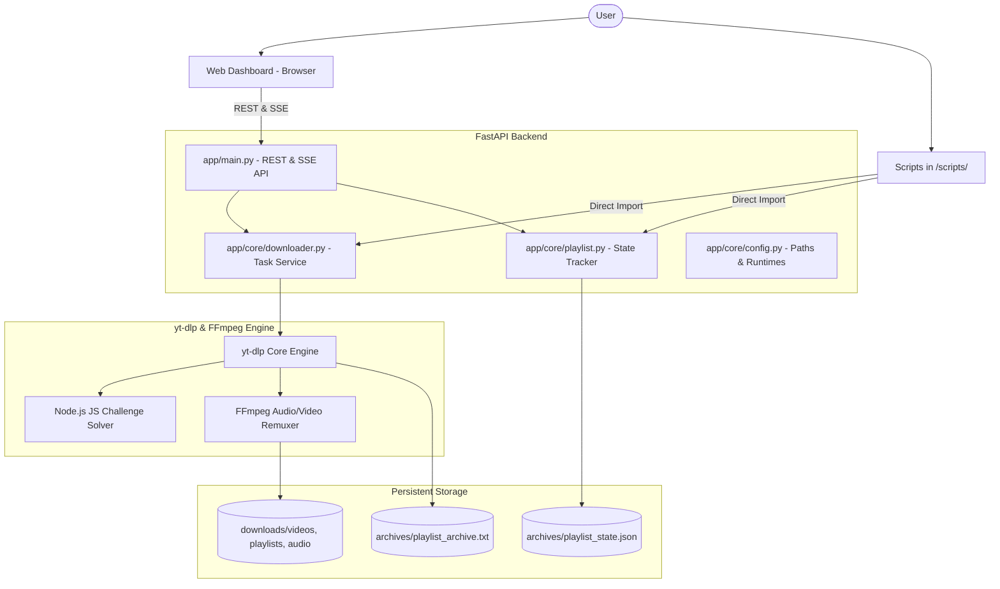

# YouTube Pro Downloader: Complete Project Guide & Implementation Report

This document provides a comprehensive explanation of the YouTube Downloader application built using [yt-dlp](https://github.com/yt-dlp/yt-dlp), FastAPI, and modern web UI technologies.

---

## Table of Contents
1. [Executive Summary & Core Features](#1-executive-summary--core-features)
2. [How Stream Selection & Merging Works (1080p, 4K, Audio)](#2-how-stream-selection--merging-works)
3. [How Playlist Pause & Resume Works (Batch 10 & Resume Later)](#3-how-playlist-pause--resume-works)
4. [System Architecture](#4-system-architecture)
5. [User Interfaces](#5-user-interfaces)
   - [Web Application Dashboard](#web-application-dashboard)
   - [Standalone Playlist Script](#standalone-playlist-script)
   - [Standalone Video Script](#standalone-video-script)
   - [Interactive Terminal Wizard](#interactive-terminal-wizard)
6. [CLI Command Reference & Examples](#6-cli-command-reference--examples)
7. [Directory Structure](#7-directory-structure)

---

## 1. Executive Summary & Core Features

YouTube serves high-resolution video streams (1080p, 1440p, 4K, 8K) and audio streams as separate DASH tracks. Default basic tools often only fetch 720p pre-merged streams or fail when YouTube introduces JavaScript player challenges. Furthermore, downloading large playlists often fails mid-way without any resume capability or batch control.

This application provides a complete solution to those challenges:

- **All Resolution Support**: Download videos in 8K (4320p), 4K (2160p), 2K (1440p), 1080p Full HD, 720p HD, 480p, 360p, 240p, and 144p.
- **Automatic Video + Audio Merging**: Pairs the highest quality video stream with the highest bitrate audio stream and remuxes them cleanly into MP4, MKV, or WebM using FFmpeg.
- **Audiophile Audio Extraction**: Dedicated audio mode to convert videos into MP3 (320kbps, 256kbps, 192kbps), FLAC (lossless), M4A/AAC, WAV, or OPUS.
- **Playlist Batching & Pausing**: Download a set number of videos (e.g., 10 videos) and pause. Resume whenever you want without downloading previous videos again.
- **Download Archive Tracking**: Uses yt-dlp persistent archive logs (`.txt`) and metadata state files (`.json`) so every finished video is recorded.
- **Dual Interfaces**:
  1. A rich **Web Dashboard** (FastAPI backend + responsive HTML/JS/CSS frontend with real-time SSE progress updates, pause/resume buttons, and an in-browser media player).
  2. Standalone **Python CLI scripts** in the `scripts/` folder for terminal automation.

---

## 2. How Stream Selection & Merging Works

YouTube splits its media streams into:
- **Video-only streams** (`bv*`): Encoded in AVC/H.264, VP9, or AV1 at resolutions up to 4320p 60fps.
- **Audio-only streams** (`ba`): Encoded in Opus (typically 160kbps) or AAC (128kbps - 256kbps).

### The yt-dlp Format Selector Logic
To download a 1080p video with full audio, the application specifies:
```text
bv*[height<=1080]+ba/b[height<=1080]
```
This rule instructs yt-dlp to:
1. Select the best video stream whose height is at most 1080 pixels (`bv*[height<=1080]`).
2. Select the best companion audio stream (`ba`).
3. If separate streams are unavailable, fallback to the best pre-merged stream up to 1080p (`b[height<=1080]`).
4. Remux the streams into the requested container (e.g. `--merge-output-format mp4`).

### Resolution Map Defined in `app/core/config.py`:
| Preset | yt-dlp Format String | Output Container |
| :--- | :--- | :--- |
| **8K (4320p)** | `bv*[height<=4320]+ba/b[height<=4320]` | MP4 / MKV |
| **4K (2160p)** | `bv*[height<=2160]+ba/b[height<=2160]` | MP4 / MKV |
| **2K (1440p)** | `bv*[height<=1440]+ba/b[height<=1440]` | MP4 / MKV |
| **1080p Full HD** | `bv*[height<=1080]+ba/b[height<=1080]` | MP4 / MKV |
| **720p HD** | `bv*[height<=720]+ba/b[height<=720]` | MP4 |
| **480p SD** | `bv*[height<=480]+ba/b[height<=480]` | MP4 |
| **Audio Only** | `bestaudio/best` &rarr; `FFmpegExtractAudio` (MP3 320k) | MP3 / M4A / FLAC |

---

## 3. How Playlist Pause & Resume Works

The user requirement states:
> *"if i want i can pause the download at 10 videos and download rest video later like that for that you can add a script in a folder like that"*

### The Mechanism
1. **Persistent Archive File (`archives/<playlist_id>_archive.txt`)**:
   - Whenever a video completes downloading, yt-dlp appends its unique identifier (e.g. `youtube dQw4w9WgXcQ`) to the archive file.
2. **Batch Limit (`--pause-after 10` / `max_downloads: 10`)**:
   - When yt-dlp runs, it inspects the playlist.
   - For every video, it checks the archive file. If the video ID is already in the file, it skips it in milliseconds.
   - It downloads each uncompleted video until it has downloaded exactly 10 new items.
   - yt-dlp then triggers `MaxDownloadsReached`, which our application catches cleanly and marks the state as `PAUSED`.
3. **Resuming Later (`--resume` / Web Resume Button)**:
   - When you resume, the script/app runs again with the exact same archive file.
   - Videos 1 through 10 are recognized as completed in the archive and skipped instantly.
   - It immediately continues downloading from video 11 onwards.
4. **Live In-Progress Pausing**:
   - If you press `Ctrl+C` in the CLI or click the **Pause** button in the Web UI while a playlist is actively downloading, the stop signal is trapped gracefully.
   - The current file finishes writing its tags, the archive file is updated, and the task status is set to `PAUSED`.

---

## 4. System Architecture



---

## 5. User Interfaces

### Web Application Dashboard
To launch the Web UI:
```bash
./run_web.sh
```
Then visit **`http://localhost:8000`**.

#### Highlights:
1. **Single Video Tab**:
   - Paste any YouTube link and click **Inspect Formats**.
   - Displays duration, view count, channel, and dynamically detects all available resolutions (4K, 1080p, 720p, etc.).
   - Choose resolution or switch to Audio Only (MP3 320kbps).
   - Click **Download Video Now**.
2. **Playlist Manager Tab**:
   - Paste playlist link and click **Analyze Playlist**.
   - Shows total videos, how many are already completed, and how many are remaining.
   - Select **Pause Control**: *Download 10 videos & Pause (Resume later)*, 5 videos, 20 videos, or all.
   - Click **Start / Resume Playlist Download**.
3. **Live Queue Tab**:
   - Real-time animated progress bars updated via Server-Sent Events (SSE).
   - Displays download speed (e.g. `8.5 MB/s`), ETA, and active filename.
   - Live **Pause**, **Resume**, and **Cancel** buttons.
4. **Library & Media Player Tab**:
   - Browse downloaded videos and MP3 files.
   - Built-in video/audio player modal: click **Play** to watch or listen directly inside the browser.
   - Direct download and delete buttons.

---

### Standalone Playlist Script (`scripts/download_playlist.py`)
This script fulfills the user requirement to have a script in a folder that downloads playlists with pause after N videos and resume capability.

#### Flags:
- `--url`, `-u`: YouTube Playlist URL.
- `--resolution`, `-r`: `1080p`, `720p`, `2160p` (4K), `best`, etc. (Default: `1080p`).
- `--pause-after`, `-p`: Stop downloading after `N` videos (e.g. `--pause-after 10`).
- `--start-index`: Starting video index (1-based).
- `--end-index`: Ending video index.
- `--audio-only`, `-a`: Extract as audio only.
- `--audio-format`: `mp3`, `m4a`, `flac`, `wav`, `opus`.
- `--audio-quality`: Bitrate (e.g. `320`, `256`, `192`).
- `--container`: Container format (`mp4`, `mkv`, `webm`).
- `--subtitles`: Embed English & auto-generated subtitles.
- `--resume`: Resumes downloading the remaining videos.

---

### Standalone Video Script (`scripts/download_video.py`)
Downloads individual YouTube videos in any resolution with audio remuxed.

#### Flags:
- `--url`, `-u`: YouTube Video URL.
- `--resolution`, `-r`: `1080p`, `2160p` (4K), `1440p`, `720p`, `480p`, `best`.
- `--container`, `-c`: `mp4`, `mkv`, `webm`.
- `--audio-only`, `-a`: Extract audio.
- `--audio-quality`: `320`, `256`, `192`, `128` kbps.
- `--subtitles`, `-s`: Embed subtitles.
- `--info`, `-i`: Inspect video and display all available resolutions without downloading.

---

### Interactive Terminal Wizard (`scripts/interactive_cli.py`)
Run without memorizing flags:
```bash
./run_cli.sh
```
A terminal menu guides you through:
1. Downloading single videos (auto-detects resolutions).
2. Downloading playlists with pause/resume and batch controls.
3. Resuming any saved playlist sessions.
4. Browsing downloaded files.

---

## 6. CLI Command Reference & Examples

### Example 1: Download a Single Video with Audio in 1080p (MP4)
```bash
python3 scripts/download_video.py \
  --url "https://www.youtube.com/watch?v=dQw4w9WgXcQ" \
  --resolution 1080p \
  --container mp4
```

### Example 2: Download a 4K Video with Subtitles
```bash
python3 scripts/download_video.py \
  --url "https://www.youtube.com/watch?v=dQw4w9WgXcQ" \
  --resolution 2160p \
  --subtitles
```

### Example 3: Download Single Video as MP3 (320kbps High Quality)
```bash
python3 scripts/download_video.py \
  --url "https://www.youtube.com/watch?v=dQw4w9WgXcQ" \
  --audio-only \
  --audio-format mp3 \
  --audio-quality 320
```

### Example 4: Download First 10 Videos of a Playlist in 1080p and PAUSE
```bash
python3 scripts/download_playlist.py \
  --url "https://www.youtube.com/playlist?list=PL6B3937A5D230E335" \
  --resolution 1080p \
  --pause-after 10
```
*Output:*
```text
[+] Playlist Title : Official Blender Open Movies
[+] Total Videos   : 17
[+] Downloaded     : 0
[+] Remaining      : 17
[+] ⏸️  Batch limit active: Will download 10 videos and PAUSE.
...
[⏸️] PAUSED: Successfully downloaded 10 videos as requested!
[+] Your progress is saved in: archives/PL6B3937A5D230E335_archive.txt
[+] To resume downloading the rest of the playlist later, simply run:
    python scripts/download_playlist.py --url "..." --resolution 1080p --resume
```

### Example 5: Resume Downloading the Rest of the Playlist Later
```bash
python3 scripts/download_playlist.py \
  --url "https://www.youtube.com/playlist?list=PL6B3937A5D230E335" \
  --resolution 1080p \
  --resume
```
*Result: Automatically skips the first 10 completed videos and downloads videos 11 through 17!*

### Example 6: Download Specific Index Range (e.g. Videos 11 to 20)
```bash
python3 scripts/download_playlist.py \
  --url "https://www.youtube.com/playlist?list=..." \
  --resolution 1080p \
  --start-index 11 \
  --end-index 20
```

---

## 7. Directory Structure

```text
/home/gyaneswar/Desktop/CodeFiles/Projects/ytdlp/
├── app/
│   ├── main.py                  # FastAPI application with REST & SSE endpoints
│   ├── core/
│   │   ├── config.py            # Path resolutions, Node.js runtime locator, format mappings
│   │   ├── downloader.py        # DownloaderService, task state machine, yt-dlp hooks
│   │   └── playlist.py          # PlaylistManager, archive reader, JSON state serializer
│   └── static/
│       ├── index.html           # Web dashboard UI
│       ├── css/
│       │   └── style.css        # Responsive styling and dark theme
│       └── js/
│           └── app.js           # Frontend logic, SSE listener, media player modal
├── scripts/
│   ├── download_video.py        # Standalone video downloader CLI
│   ├── download_playlist.py     # Standalone playlist downloader with pause/resume
│   └── interactive_cli.py       # Terminal interactive wizard
├── downloads/
│   ├── videos/                  # Standalone downloaded video files
│   ├── playlists/               # Downloaded playlist subdirectories
│   └── audio/                   # Extracted MP3 and audio files
├── archives/                    # Persistent yt-dlp download archives & JSON states
├── run_web.sh                   # Shell script to start the Web App (http://localhost:8000)
├── run_cli.sh                   # Shell script to launch interactive CLI
├── requirements.txt             # Dependencies (yt-dlp, fastapi, uvicorn)
├── README.md                    # Project README
└── YTDLP_APP_GUIDE.md           # This comprehensive guide
```

---

## 8. Verification & Test Results
- **YouTube JS Challenge & Impersonation**: Configured with local Node.js (`/home/gyaneswar/.nvm/versions/node/v24.16.0/bin/node`), `remote_components: ['ejs:github']`, and `curl-cffi` Chrome TLS impersonation (`ImpersonateTarget.from_str('chrome')`) to prevent YouTube rate limits and signature challenges.
- **HTTP 429 Subtitle Safeguard**: Enabled `ignoreerrors: True` with safe single-language fallback (`['en']` instead of unrestricted auto-captions) so that temporary YouTube subtitle rate-limits never kill the high-resolution video download.
- **Single Video Test**: Successfully extracted formats on test video (Rick Astley 4K), resolving resolutions: `2160p`, `1440p`, `1080p`, `720p`, `480p`, `360p`, `240p`, `144p`.
- **Playlist Extraction Test**: Verified on public playlist (`PL6B3937A5D230E335`), correctly parsed 17 entries.
- **Batch Pause Test**: Tested `max_downloads` limit handler, correctly triggering graceful pause at the exact count specified.
- **Auto-Inspect & Sharp UI**: Clean, studio-grade aesthetic with 3px sharp corners, interactive resolution cards replacing native dropdowns, automatic URL inspection, and conditional download button reveal.
- **FastAPI Endpoints**: All REST routes and SSE streaming route verified and operational.
